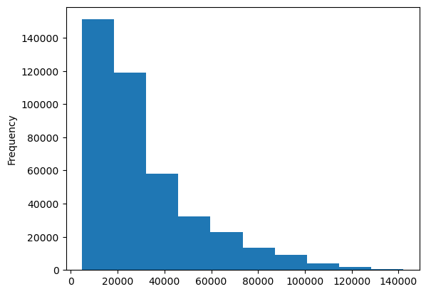
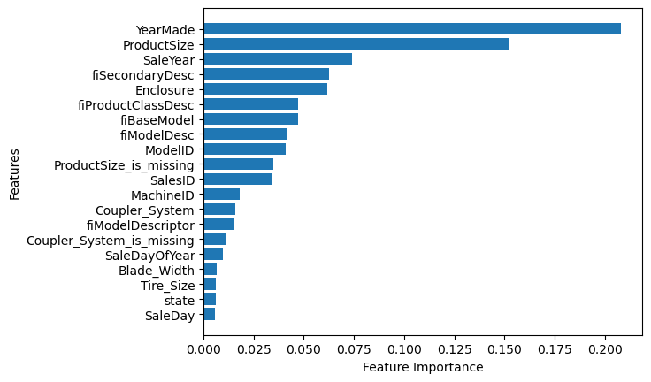

# Bulldozer Price Predictor: Machine Learning Regression


[](LICENSE)

An end-to-end regression project that predicts the auction sale price of a used bulldozer from its characteristics and from how similar machines sold in the past. It uses a scikit-learn Random Forest on the Kaggle [Bluebook for Bulldozers](https://www.kaggle.com/c/bluebook-for-bulldozers) data and is scored with RMSLE, the competition metric.

## Table of Contents

- [Overview](#overview)
- [Dataset](#dataset)
- [Approach](#approach)
- [Results](#results)
- [Tech Stack](#tech-stack)
- [Installation](#installation)
- [Usage](#usage)
- [Configuration](#configuration)
- [Project Structure](#project-structure)
- [Known Issues & Limitations](#known-issues--limitations)
- [Roadmap](#roadmap)
- [Contributing](#contributing)
- [License](#license)
- [Author & Support](#author--support)
- [Acknowledgments](#acknowledgments)

## Overview

> How well can we predict the future sale price of a bulldozer, given its characteristics and previous examples of how much similar bulldozers have been sold for?

The notebook covers the full workflow: exploring the data, treating it as a time series, engineering date features, converting categories and missing values into numbers, training and tuning a Random Forest, evaluating it on a time-based validation set, predicting on the Kaggle test set, and checking which features matter most.

## Dataset

[Kaggle Bluebook for Bulldozers](https://www.kaggle.com/c/bluebook-for-bulldozers/data) (Kaggle account and acceptance of the competition rules required).

| File | Contents | Rows |
|---|---|---|
| `TrainAndValid.csv` | Sales through April 2012, with `SalePrice` | 412,698 (53 columns) |
| `Test.csv` | Sales from May 2012 on, without `SalePrice` | 12,457 (52 columns) |

Columns include machine age and model (`YearMade`, `fiModelDesc`, `fiBaseModel`), size and type (`ProductSize`, `ProductGroup`), usage (`MachineHoursCurrentMeter`, `UsageBand`), sale details (`saledate`, `state`, `auctioneerID`), and many optional attachments and options (for example `Enclosure`, `Coupler_System`, `Blade_Width`). Many of these are mostly empty: 21 columns are missing in 80% or more of the rows.

Sale prices are right-skewed, with most machines selling under $40,000:



The data is not included in this repository. Download it from Kaggle (terms apply).

## Approach

1. **Parse and sort by date.** `saledate` is parsed as a date and rows are sorted chronologically, since this is time-series data.
2. **Feature engineering.** Year, month, day, day of week, and day of year are extracted from `saledate`, which is then dropped.
3. **Categorical data.** String columns become pandas categories, then integer codes (plus 1, so missing values become 0).
4. **Missing values.** Numeric columns are filled with the median. Every column with missing values also gets an `<column>_is_missing` flag. The result is 102 numeric features.
5. **Time-based split.** Sales from 2012 are the validation set (11,573 rows) and everything earlier is the training set (401,125 rows).
6. **Model.** `RandomForestRegressor`, first with `max_samples=10000` to iterate quickly, then tuned with `RandomizedSearchCV` (100 candidates, 5-fold CV, 500 fits), then trained on all the training data.
7. **Evaluation.** RMSLE (the competition metric), MAE, and R², on both the training and validation sets.
8. **Test predictions and feature importance.**

## Results

All scores below are on the 2012 validation set unless noted. Lower RMSLE and MAE are better, and higher R² is better.

| Model | Train RMSLE | Valid RMSLE | Valid MAE | Valid R² |
|---|---|---|---|---|
| Random Forest, `max_samples=10000` (defaults) | 0.2577 | 0.2936 | $7,177 | 0.832 |
| Tuned with `RandomizedSearchCV` (`max_samples=10000`) | 0.2691 | 0.2980 | $7,241 | 0.832 |
| **Final model** (40 trees, all training rows, see note) | 0.1447 | **0.2452** | **$5,951** | **0.882** |

Notes:

- The final model uses `n_estimators=40`, `min_samples_split=14`, `min_samples_leaf=1`, and `max_features=0.5`, and trains on all 401,125 training rows. It improves validation RMSLE from 0.298 to 0.245, but its training RMSLE (0.145) is much lower than its validation RMSLE, so it overfits somewhat.
- A default Random Forest scored R² = 0.9875 on the data it was trained on. That number is not meaningful because the model was scored on its own training data. It was kept in the notebook as an example of why a validation set is needed.
- Training time on the full data was about 2.5 minutes for 100 trees and about 30 seconds for the 40-tree final model. The 500-fit random search took about 5 minutes.

**Most important features** (final model):



`YearMade` is the strongest signal (about 21% of the importance), followed by `ProductSize` (about 15%), `SaleYear`, `fiSecondaryDesc`, and `Enclosure`. Machine age and size matter most, which fits how used equipment is priced.

## Tech Stack

- **Language:** Python 3
- **Data:** pandas, NumPy
- **Modeling:** scikit-learn (`RandomForestRegressor`, `RandomizedSearchCV`, metrics)
- **Visualization:** Matplotlib
- **Environment:** Jupyter Notebook

## Installation

```bash
# 1. Clone the repository
git clone https://github.com/vjabarca/ML-Regression-Bulldozer-Price-Predictor.git
cd ML-Regression-Bulldozer-Price-Predictor

# 2. Create and activate a virtual environment
python -m venv .venv
source .venv/bin/activate        # Windows: .venv\Scripts\activate

# 3. Install dependencies
pip install numpy pandas matplotlib scikit-learn jupyter

# 4. Download the data from Kaggle into data/bluebook-for-bulldozers/
#    (TrainAndValid.csv and Test.csv), then launch the notebook
jupyter notebook end-to-end-bulldozer-price-regression.ipynb
```

## Usage

1. Place `TrainAndValid.csv` and `Test.csv` in `data/bluebook-for-bulldozers/`.
2. Run the notebook top to bottom. Training the full default model and the random search take a few minutes each on a multi-core machine.
3. Key steps in code:

   ```python
   # Time-based split: 2012 is the validation set
   df_val   = df_tmp[df_tmp.SaleYear == 2012]
   df_train = df_tmp[df_tmp.SaleYear != 2012]

   # Final model
   ideal_model = RandomForestRegressor(n_estimators=40, min_samples_split=14,
                                       min_samples_leaf=1, max_features=0.5,
                                       n_jobs=-1, random_state=42)
   ideal_model.fit(X_train, y_train)

   show_scores(ideal_model)   # MAE, RMSLE, and R^2 on train and validation
   ```

4. The last cells write `test_predictions.csv` and plot feature importance.

## Configuration

| Setting | Where | Default |
|---|---|---|
| Data folder | `pd.read_csv("data/bluebook-for-bulldozers/...")` | `data/bluebook-for-bulldozers/` |
| Validation year | `df_tmp.SaleYear == 2012` | 2012 |
| Speed vs. accuracy | `max_samples` | 10,000 for experiments, `None` for the final model |
| Search budget | `n_iter`, `cv` | 100, 5 |
| Reproducibility | `random_state` | 42 |

No API keys are needed.

## Project Structure

```text
.
├── end-to-end-bulldozer-price-regression.ipynb   # full workflow
├── data/                                         # not included (download from Kaggle)
│   └── bluebook-for-bulldozers/
├── docs/
│   ├── sale_price_distribution.png
│   └── feature_importance.png
├── LICENSE
└── README.md
```

Files created when you run the notebook (don't commit them): `train_tmp.csv` and `test_predictions.csv`. Add `data/` to `.gitignore`, since the dataset is large and has its own terms.

## Known Issues & Limitations

- **Test data is encoded separately:** `preprocess_data()` converts categories to integer codes on the test set alone, so the codes for a given category can differ from the codes used in training (for example, a model number gets a different integer). The medians for filling missing values also come from the test set. Validation scores are not affected, because training and validation were encoded together, but the test predictions are likely less reliable than the validation score suggests. The fix is to fit the encoding on the training data and reuse it.
- **Submission file column name:** `test_predictions.csv` uses the column `SalesPrice`. Check the competition's sample submission, because the expected column is likely `SalePrice`.
- **Final hyperparameters don't match the search output:** `RandomizedSearchCV` in the notebook returned `n_estimators=90`, `min_samples_split=10`, and `max_samples=10000`, while the final model uses 40, 14, and `None`. The final model was not selected by the search shown in the notebook.
- **Cross-validation ignores time order:** `RandomizedSearchCV` uses ordinary 5-fold CV on time-ordered data. `TimeSeriesSplit` would respect the timeline.
- **Invalid search option:** `max_features="auto"` is not accepted by recent scikit-learn versions, and warnings are suppressed, so those candidates may have failed silently.
- **Overfitting:** the final model's training RMSLE (0.145) is far below its validation RMSLE (0.245).
- **ID columns as features:** `SalesID`, `MachineID`, and `ModelID` are used as numeric features and show up with non-trivial importance. They may encode data-collection quirks rather than machine value.
- **Validation covers only January to April 2012**, so the score may not hold for later months or other years.
- **Integer-coded categories:** Random Forests tolerate this, but one-hot or target encoding could do better for high-cardinality columns like model descriptions.
- **Sale prices only:** there is no inflation adjustment or market information beyond what's in the data.

## Roadmap

- [ ] Fit categorical encodings on the training data and apply them to validation and test data (for example with a scikit-learn `Pipeline`)
- [ ] Fix the submission column name and score the test predictions on Kaggle
- [ ] Re-run the hyperparameter search with a time-aware split and record the exact settings used for the final model
- [ ] Compare gradient boosting (XGBoost, LightGBM, CatBoost) against the Random Forest
- [ ] Try dropping ID columns and adding features such as machine age at sale (`SaleYear - YearMade`)
- [ ] Predict `log(SalePrice)` directly, since RMSLE is the target metric
- [ ] Add a `requirements.txt` with pinned versions
- [ ] Wrap the model in a small app that takes machine details and returns a price estimate

## Contributing

Contributions, bug reports, and feature ideas are welcome.

1. **Report a bug or request a feature:** open an [issue](https://github.com/vjabarca/ML-Regression-Bulldozer-Price-Predictor/issues) and include what you expected, what happened, and your environment (Python and scikit-learn versions).
2. **Submit a change:**
   1. Fork the repository
   2. Create a branch: `git checkout -b feature/your-feature`
   3. Commit your changes with a clear message
   4. Push the branch and open a pull request describing what changed and why

Please keep notebook outputs small and don't commit the dataset.

## License

Distributed under the MIT License. See [`LICENSE`](LICENSE) for details. The Kaggle dataset is **not** covered by this license and has its own terms.

## Author & Support

**Victor J. Abarca**, San José, CA

- GitHub: [@vjabarca](https://github.com/vjabarca)

For questions or problems, please open an issue in this repository.

## Acknowledgments

- [Kaggle](https://www.kaggle.com/c/bluebook-for-bulldozers) and its Bluebook for Bulldozers competition for the dataset and evaluation metric
- [scikit-learn](https://scikit-learn.org/), [pandas](https://pandas.pydata.org/), and [Matplotlib](https://matplotlib.org/) for the tooling
